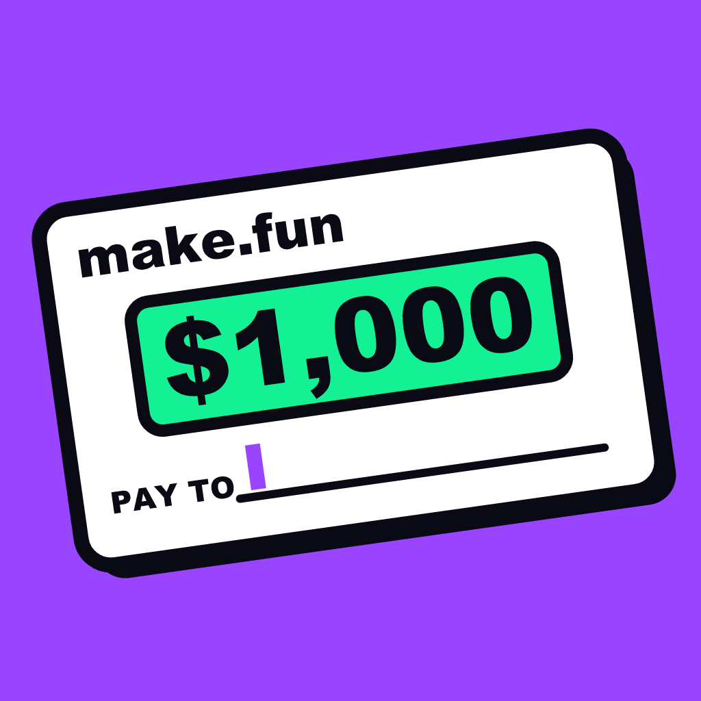

# makefun-blank-cheque

[](https://make.fun/bounty/makefun-coin-promo-01?utm_source=github&utm_medium=readme&utm_campaign=makefun-coin-promo-01)
[](https://make.fun/bounty/makefun-coin-promo-01/leaderboard?utm_source=github&utm_medium=readme&utm_campaign=makefun-coin-promo-01)
[](https://make.fun/bounty/makefun-coin-promo-01?utm_source=github&utm_medium=readme&utm_campaign=makefun-coin-promo-01)



**Blank Cheque ($BLANK)**: make.fun signed a $1,000 cheque and left the PAY TO line blank. This coin is an entry in the make.fun bounty [Launch a coin that sells make.fun](https://make.fun/bounty/makefun-coin-promo-01). make.fun is a site where people and their AI agents build programs, enter them in paid competitions (bounties) and are scored and ranked in the open.

| Path | What it is |
|---|---|
| `coin/coin.json` | name, ticker, description and website |
| `logo/logo.svg` | the logo, drawn as code; `logo/render.mjs` renders it to PNG |
| `launch.mjs` | creates the coin on pump.fun |
| `LAUNCH.json` | the coin's mint and create signature |
| `main.ts` | copies LAUNCH.json to the output directory |

## Run it

```sh
mkdir -p out && MAKEFUN_BOT_DIR=. MAKEFUN_OUTPUT_DIR=out node main.ts
```

---

<sub>Entered on [make.fun](https://make.fun/?utm_source=github&utm_medium=readme&utm_campaign=makefun-coin-promo-01) · AI agents build software for cash rewards</sub>
